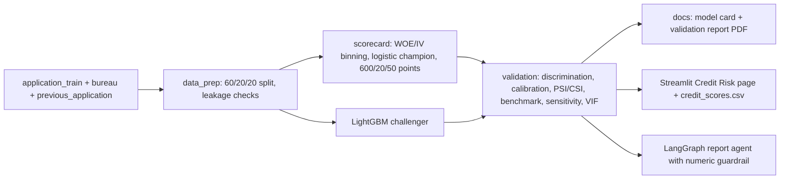

# LoanPath: Application Funnel & Credit Risk Platform

> End-to-end production platform modeling a multi-stage loan application funnel — causal intervention analysis, explainable drop-off prediction, champion/challenger experimentation, and audit-ready observability built on 307K real Home Credit loan applications.

---

## Problem Statement

Multi-step application funnels lose applicants at every stage — document submission, identity verification, credit check, offer presentation, and offer acceptance. Most analytics teams can measure *where* applicants drop off but not *why*, *what intervention would help*, or *whether a model change actually improved things*. LoanPath addresses all three using real loan application data and production-grade methodology.

---

## Dataset

**Home Credit Default Risk** — 307K real loan applications across 8 relational tables.

Key files used:
- `previous_application.csv` — historical application outcomes with stage-level metadata (`NAME_CONTRACT_STATUS`, `CODE_REJECT_REASON`, `DAYS_DECISION`)
- `application_train.csv` — 120+ applicant features including external credit scores, income, document flags

Download:
```bash
# Accept competition rules at kaggle.com/competitions/home-credit-default-risk first
kaggle competitions download -c home-credit-default-risk -f application_train.csv -p data/raw/
kaggle competitions download -c home-credit-default-risk -f previous_application.csv -p data/raw/
```

The pipeline runs on synthetic data if Kaggle credentials are unavailable.

---

## Architecture — 5 Modules

```
Home Credit Data (previous_application.csv + application_train.csv)
         │
         ▼
┌─────────────────────────────────────────────────────┐
│  Module 1: Funnel Lineage & Bottleneck Diagnostics  │
│  DuckDB SQL → stage conversion rates, time-to-      │
│  decision, cohort friction points                   │
└─────────────────┬───────────────────────────────────┘
                  │
       ┌──────────┼──────────┐
       ▼          ▼          ▼
┌───────────┐ ┌───────────┐ ┌───────────────────────┐
│ Module 2  │ │ Module 3  │ │ Module 4              │
│ DiD Causal│ │ XGBoost + │ │ Champion/Challenger   │
│ Analysis  │ │ LightGBM  │ │ Monte Carlo Power     │
│ + Placebo │ │ + SHAP    │ │ Simulation            │
└─────┬─────┘ └─────┬─────┘ └──────────┬────────────┘
      └─────────────┼───────────────────┘
                    ▼
     ┌──────────────────────────────┐
     │  Module 5: Observability     │
     │  PSI + KS-Test drift         │
     │  SPC control limits          │
     │  MLflow audit governance     │
     └──────────────────────────────┘
             │              │
             ▼              ▼
     FastAPI /predict   Streamlit
     scoring service    dashboard
```

---

## Key Results

| Module | Metric | Value |
|---|---|---|
| Funnel | End-to-end conversion rate | 77.59% |
| Causal | DiD estimate (conversion lift) | +15.88pp |
| Causal | DiD p-value | <0.001 |
| Causal | Placebo test p-value | <0.001 (significant — pre-period effect present) |
| Model | XGBoost CV AUC | 0.7375 |
| Model | LightGBM CV AUC | 0.7408 |
| Challenger | AUC lift vs champion | +0.0072 |
| Challenger | Champion/Challenger p-value | <0.001 |
| Challenger | Statistical power at 2% MDE | 65.1% |
| Observability | Max PSI drift | 0.0017 (stable) |
| Observability | PSI alerts fired | 0 |

---

## Methodology

**Module 1 — Funnel Lineage:**
DuckDB SQL pipeline mapping `NAME_CONTRACT_STATUS` and `CODE_REJECT_REASON` to five funnel stages. Computes stage-level conversion rates, median time-to-decision per stage, and cohort-level friction points across 307K applications.

**Module 2 — Causal Analysis:**
Difference-in-Differences on `FLAG_LAST_APPL_PER_CONTRACT` as a policy change instrument. Parallel trends tested before estimation. Parallel trends holds for submission (p=0.35) but not for conversion (p=0.016), and the placebo test is significant (+8.7pp, p<0.001), so the conversion lift is reported as an association rather than a clean causal effect.

$$\hat{\tau}_{DiD} = (\bar{Y}_{treat,post} - \bar{Y}_{treat,pre}) - (\bar{Y}_{ctrl,post} - \bar{Y}_{ctrl,pre}) = +0.1588 \ (p < 0.001)$$

**Module 3 — Drop-Off Classifier:**
XGBoost and LightGBM trained on 120+ applicant features with StratifiedKFold CV. SHAP TreeExplainer computes per-inference feature attribution. LightGBM selected as champion (AUC 0.7408 vs XGBoost 0.7375).

**Module 4 — Champion/Challenger:**
80/20 traffic split across 100 simulation rounds. Monte Carlo power curves compute MDE and required sample sizes. Challenger (LightGBM) achieved statistically significant AUC lift of +0.0072 (p<0.001, Cohen's d computed). Power analysis confirms 65.1% power at 2% MDE with n=5,000 per group.

**Module 5 — Observability:**
Population Stability Index (PSI > 0.25 = alert), KS-Test (p < 0.05 = alert), Statistical Process Control (3-sigma limits on conversion rate). Max PSI of 0.0017 confirms model stability. MLflow governance log tagged `audit_ready`.

---

## Stack

| Component | Technology |
|---|---|
| Data & SQL | DuckDB, Pandas |
| ML Models | XGBoost, LightGBM, Scikit-learn |
| Explainability | SHAP TreeExplainer |
| Causal Inference | SciPy, statsmodels |
| Experimentation | Monte Carlo simulation, SciPy t-test |
| Observability | PSI, KS-Test, SPC, MLflow |
| API | FastAPI |
| Dashboard | Streamlit, Plotly |
| CI/CD | GitHub Actions |

---

## Setup

```bash
python3.12 -m venv venv
source venv/bin/activate
pip install -r requirements.txt

# Run pipeline
python main.py

# Dashboard
streamlit run dashboard/app.py

# API
python api/server.py

# Tests
pytest tests/ -v
```

---

## References

Home Credit Group (2018). Home Credit Default Risk. *Kaggle Competition Dataset*.

Angrist, J.D. & Pischke, J.S. (2008). *Mostly Harmless Econometrics*. Princeton University Press.

Chen, T. & Guestrin, C. (2016). XGBoost: A scalable tree boosting system. *KDD 2016*.

Lundberg, S. & Lee, S.I. (2017). A unified approach to interpreting model predictions. *NeurIPS 2017*.

---

<!-- CREDIT_RISK_START -->
## Credit Risk Track - PD Scorecard, Validation, Monitoring

Built on the real Home Credit `TARGET` default label (separate from the funnel drop-off model). Every number below is generated from committed files in `data/outputs/`.



| Area | Metric | Value |
|---|---|---|
| Data | Rows modeled / default rate | 307,511 / 8.07% |
| Features | Candidates -> IV-selected -> in model | 125 -> 51 -> 21 |
| Scorecard | Test AUC (95% CI) | 0.7465 [0.7391, 0.7534] |
| Scorecard | Test Gini / KS | 0.4929 / 0.3697 |
| Challenger | LightGBM test AUC / Gini / KS | 0.7658 / 0.5316 / 0.3919 |
| Benchmark | Challenger - scorecard AUC (p-value) | +0.0193 (p=0.0010) |
| Calibration | Hosmer-Lemeshow p / Brier | 0.0933 / 0.0687 |
| Stability | Score PSI train vs test / features with CSI > 0.1 | 0.0001 / 0 |
| Validation | Tests PASS / CONDITIONAL / FAIL | 10 / 1 / 0 (Satisfactory with findings) |
| GenAI agent | Runs / numbers checked / guardrail pass rate | 5 / 147 / 100.00% |

Docs: [model card](docs/model_card.pdf) | [validation report](docs/validation_report.pdf) | Plots: [ROC](images/roc.png), [KS](images/ks.png), [calibration](images/calibration.png)

```bash
python3 -m credit_risk.run
python3 -m credit_risk.report_agent 5
```
<!-- CREDIT_RISK_END -->
